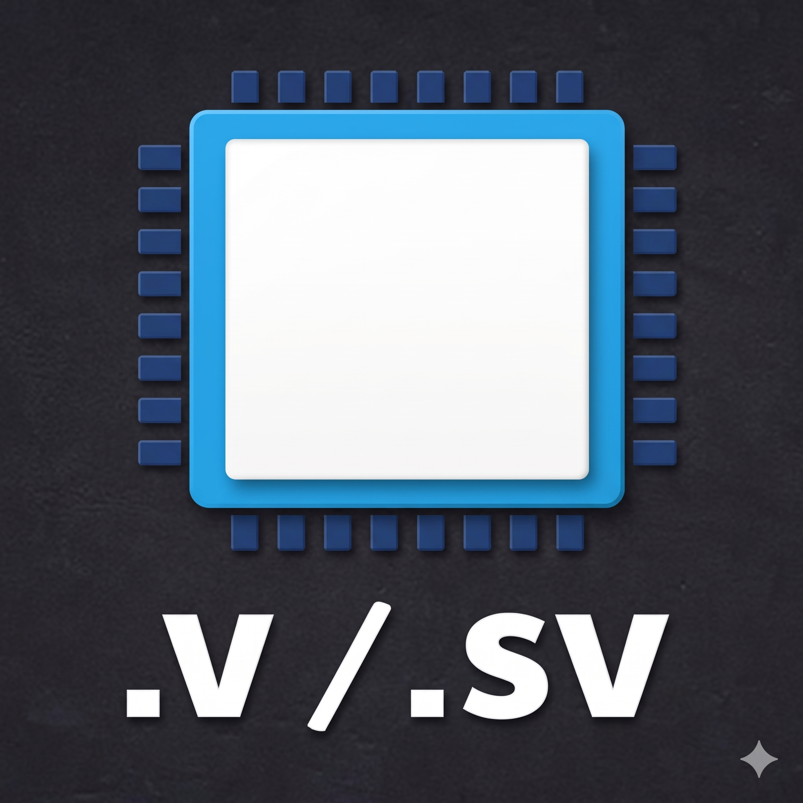
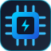
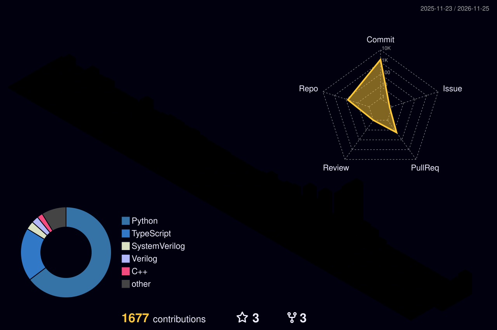

   

  
  
  

 

---

### 🛠 **The Tech Arsenal**

<table align="center">
  <tr>
    <td align="center" width="96">
      
       Python
    </td>
    <td align="center" width="96">
      
       C++
    </td>
    <td align="center" width="96">
      
       Embedded C
    </td>
   <td align="center" width="96">
      
       Verilog / SV
    </td>
    <td align="center" width="96">
      
       ESP32 / IDF
    </td>
    <td align="center" width="96">
      
       Linux
    </td>
  </tr>
  <tr>
    <td align="center" width="96">
      
       TinyML
    </td>
    <td align="center" width="96">
      
       LoRaWAN
    </td>
    <td align="center" width="96">
      
       Arduino
    </td>
    <td align="center" width="96">
      
       Git
    </td>
    <td align="center" width="96">
      
       VS Code
    </td>
    <td align="center" width="96">
      
       Actions
    </td>
  </tr>
</table>

---

###  **Featured Deployments**

| Project | Description & Tech | Impact |
| :--- | :--- | :--- |
|  **AWAKE Event-Driven ASIC** | **Stack:** `Verilog` `OpenLane` `OpenROAD` `Sky130`   Event-driven sensor ASIC with adaptive ADC, event-detection logic, and hierarchical power FSM. | Achieved timing closure at **116.15 MHz** on SkyWater 130nm with zero setup/hold violations. |
|  **HSA-16 AI Accelerator** | **Stack:** `Verilog HDL` `Cadence Genus` `Xcelium` `SAIF`   16×16 INT8 sparsity-aware systolic-array accelerator with lookahead sparsity and dynamic clock gating. | Cuts redundant MAC activity on sparse workloads and models real switching power via SAIF. |
|  **AgriAgents** | **Stack:** `LangGraph` `Flask` `Python` `ESP32 IoT`   4-agent climate-aware irrigation system combining telemetry, weather context, and tool-calling agents. | Automates multi-step agricultural decision workflows with transparent agent reasoning and live monitoring. |
|  **AI-Assisted CABG Decision Support** | **Stack:** `Next.js` `FastAPI` `PostgreSQL` `OpenCV` `OCR`   Full-stack clinical workflow combining computer vision/OCR extraction, REST APIs, and structured reporting. | Streamlines medical record ingestion, retrieval, and automated PDF clinical report generation. |

---

###  **GitHub Intelligence**

  
  

 

  <picture>
    <source media="(prefers-color-scheme: dark)" srcset="https://raw.githubusercontent.com/aashishniranjanb/aashishniranjanb/output/github-contribution-grid-snake-dark.svg">
    <source media="(prefers-color-scheme: light)" srcset="https://raw.githubusercontent.com/aashishniranjanb/aashishniranjanb/output/github-contribution-grid-snake.svg">
    
  </picture>

 

  

---

###  **Transmission Lines**

  
  
  
  

 

  <i>"Optimization is the root of all engineering."</i>

