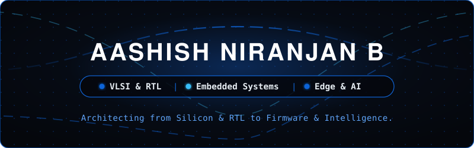

   

  
  
  
  

 

 

  

 

###  **About Me**

> *"Optimization is the root of all engineering."*

Final-year **ECE** builder at **SRMIST** (Class of 2027) taking ideas from **RTL & ASIC signoff** down to **edge firmware** and **full-stack AI systems**.

| Layer | Core Stack |
| :--- | :--- |
| **Silicon & RTL** | `Verilog` `SystemVerilog` `UVM` `RTL-to-GDSII` `STA` `Cadence` `Synopsys` `OpenLane` |
| **Embedded & Edge** | `Embedded C/C++` `ESP32` `STM32` `FPGA` `RTOS` `LoRaWAN` |
| **AI & Software** | `Python` `PyTorch` `TinyML` `LangGraph` `FastAPI` `PostgreSQL` `Next.js` |

<b>Research & Honors</b>

 

**Publications**
- **IEEE ITC India 2026 (Academia Research Track):** Cross-layer FeFET degradation-aware fault modeling for non-volatile memory[cite: 3, 4, 6].
- **ICOSAAS 2026 (IEEE Xplore):** Test-aware slack monitoring for reliable FIR filters[cite: 3, 4].
- **ICACAS 2026:** Predictive slack-aware self-optimizing accelerator for edge computing[cite: 4].
- **ICAME 2026 & ICECSM 2026:** Embedded machine learning and adaptive edge-AI frameworks[cite: 4].

**Competitions & Honors**
- **SEMICON 2026:** Top 13 Team in India.
- **IEEE ITC India 2026 Hackathon:** 2nd Place (cross-layer non-volatile memory testing framework)[cite: 3, 4, 6].
- **IEEE ITC India 2026 (Academia Research Track):** Top-5 selection[cite: 4].
- **SAE Tier-1 Competition:** 2nd Place in Mobile App Development[cite: 4, 6].
- **Loyola-ICAM National Symposium:** 2nd Place (AI Accelerators) and 3rd Place (Energy Saving Frameworks)[cite: 4].

 

  

 

###  **The Tech Arsenal**

<table align="center">
  <tr>
    <td align="center" width="96">
      
       Python
    </td>
    <td align="center" width="96">
      
       C++
    </td>
    <td align="center" width="96">
      
       Embedded C
    </td>
    <td align="center" width="96">
      
       Verilog / SV
    </td>
    <td align="center" width="96">
      
       ESP32 / IDF
    </td>
    <td align="center" width="96">
      
       Linux
    </td>
  </tr>
  <tr>
    <td align="center" width="96">
      
       TinyML
    </td>
    <td align="center" width="96">
      
       LoRaWAN
    </td>
    <td align="center" width="96">
      
       Arduino
    </td>
    <td align="center" width="96">
      
       Git
    </td>
    <td align="center" width="96">
      
       VS Code
    </td>
    <td align="center" width="96">
      
       Actions
    </td>
  </tr>
</table>

 

  

 

###  **Featured Deployments**

| Project | Description & Tech | Impact |
| :--- | :--- | :--- |
|  [**AWAKE Event-Driven ASIC**](https://github.com/aashishniranjanb/awake_2.0) | **Stack:** `Verilog` `OpenLane` `OpenROAD` `Sky130`   Event-driven sensor ASIC with adaptive ADC, event-detection logic, and hierarchical power FSM. | Closed timing at **116.15 MHz** on SkyWater 130nm with zero setup/hold violations. |
|  [**HSA-16 AI Accelerator**](https://github.com/aashishniranjanb/HSA16-AI-Accelerator) | **Stack:** `Verilog HDL` `Cadence Genus` `Xcelium` `SAIF`   16×16 INT8 sparsity-aware systolic-array accelerator with lookahead sparsity and dynamic clock gating. | Cuts redundant MAC activity on sparse workloads and models real switching power via SAIF. |
|  [**AgriAgents**](https://github.com/aashishniranjanb/TERRA-AGENT-Smart-Irrigation) | **Stack:** `LangGraph` `Flask` `Python` `ESP32 IoT`   4-agent climate-aware irrigation system combining telemetry, weather context, and tool-calling agents. | Automates multi-step agricultural decision workflows with transparent agent reasoning and live monitoring. |
|  [**AI-Assisted CABG Decision Support**](https://github.com/aashishniranjanb/ai-assisted-cabg-clinical-decision-support) | **Stack:** `Next.js` `FastAPI` `PostgreSQL` `OpenCV` `OCR`   Full-stack clinical workflow combining computer vision/OCR extraction, REST APIs, and structured reporting. | Streamlines medical record ingestion, retrieval, and automated PDF clinical report generation. |

 

  

 

###  **GitHub Intelligence**

  
  

 

  <picture>
    <source media="(prefers-color-scheme: dark)" srcset="https://raw.githubusercontent.com/aashishniranjanb/aashishniranjanb/output/github-contribution-grid-snake-dark.svg">
    <source media="(prefers-color-scheme: light)" srcset="https://raw.githubusercontent.com/aashishniranjanb/aashishniranjanb/output/github-contribution-grid-snake.svg">
    
  </picture>

 

  

 

  

 

###  **Transmission Lines**

  
  
  
  

 

  <i>"Optimization is the root of all engineering."</i>

